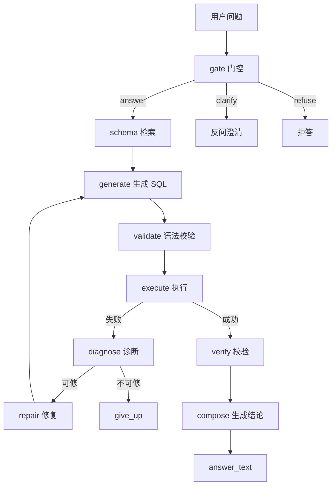

# DataPilot — Text-to-SQL 数据分析 Agent 评测框架

用「评测先行 + 消融矩阵」的方法，把一条最朴素的 Text-to-SQL 基线（A0）逐步演进成带检索、修复环、gate 门控、verifier、缓存路由的可靠 Agent（A4），并在三个库（chinook / sakila / 自建 ecommerce）上量化每个组件的收益与代价。

**核心问题**：LLM 直接生成 SQL 有两个致命问题——**答错**（语义误解、枚举猜错、口径混乱）和**答错还自信**（编造结论）。本项目不追求"又一个能跑的 SQL Agent"，而是回答一个更难的问题：**每一个可靠性组件到底有没有用、代价多大？**

## 消融结果（v2，数据可溯源到 `experiments/runs/v2_{库}_{配置}`）

| 库 | A0 基线 | A3（+检索/修复环/gate/verifier） | A4（+缓存/路由） | 结论 |
| --- | --- | --- | --- | --- |
| chinook | 75.0% | **83.3%** | 79.2% | 可靠性组件 +8.3pt |
| sakila | 72.2% | 72.2% | 66.7% | 持平（小样本波动） |
| ecommerce（自建） | 88.4% | **90.7%** | 86.0% | headroom 不足，见下 |

**关键发现（诚实结论，含负结果）**：

- **检索（A1）三库全比 A0 低**（漏召砍 EX），这是"省 token 的代价"，靠 A2/A3 的修复环回补。
- **verifier 的 LLM judge 零收益**（三库 `verify_fixed` 全 0），已降级为确定性 guard——降级后 EX 不降反升（chinook_a3 79.2%→83.3%）。
- **自建 ecommerce 库**是防污染论据：模型训练语料里没见过这套 schema，它上面的 EX 才是泛化能力的下限估计。
- ⚠️ **已知局限**：ecommerce 的 A0=88.4% 越过 headroom 红线（>85%），说明该库的"难题"对当前模型还不够难；错误自信率 = 2/30 ≈ 6.7%（两条是"截断当全体 / NULL 未标注"的表达瑕疵，非编造幻觉）。

## 架构



## 快速开始

```bash
# 1. 装依赖（需要 uv，会读 pyproject 里的清华源）
uv sync

# 2. 配置模型（复制 .env.example 填 api_key / base_url / model）
cp .env.example .env   # 然后填 DP_API_KEY / DP_BASE_URL / DP_MODEL

# 3. 跑一条单题提问（走 A3 全链路：检索 + gate + 修复环 + 结论）
uv run python -m src.datapilot.cli ask "每个国家客户总消费额前 5 名"

# 4. 跑评测（--limit 1 先冒烟，去掉则全量）
uv run python -m src.datapilot.cli eval --config a3 --dataset data/benchmarks/chinook_v0.jsonl --limit 1

# 5. 看调用链（可观测）
uv run python -m src.datapilot.cli ask "..." --trace experiments/trace/demo.jsonl
uv run python -m src.datapilot.obs.trace_viewer experiments/trace/demo.jsonl

# 6. 网页 Demo（Streamlit）
uv run streamlit run app.py
```

## 目录结构

- `src/datapilot/` — 核心代码
  - `pipelines/` — A0–A4 五档配置（A0 基线 / A1 检索 / A2 修复环 / A3 gate+verifier / A4 缓存+路由）
  - `nodes/` — 图节点（gate / retrieve / generate / validate / execute / diagnose / repair / verify / compose）
  - `eval/` — 评测（runner / metrics / gold_tables / verify_gold）
  - `obs/` — 可观测（tracer / trace_viewer）
  - `tools/` — schema 单元化 + SQL 执行器
  - `llm/` — LLM 客户端 + 缓存
- `data/benchmarks/` — 三库评测集（.jsonl + glossary 业务口径）
- `data/dbs/` — 三个 SQLite 库（chinook / sakila / 自建 ecommerce）
- `eval/configs/` — a0~a4 的 YAML 配置
- `experiments/runs/` — 评测结果（按 `v2_{库}_{配置}` 命名）
- `reports/` — 消融报告 / 人工抽评表 / 核验报告
- `docs/` — 总手册 + Day 1~7 分日手册 + 日报 + 设计文档 + 失败案例

## 核心指标定义

- **EX**：执行结果等价（多重集比较，非文本相似度）——SQL 写法千千万，文本相似会误判，执行结果才是"对不对"的唯一真相。
- **ex_first / repair_gain**：首轮正确率 / 修复环带来的增益。
- **schema_recall**：检索召回率（BM25 + 外键一跳）。
- **behavior_ok**：特殊题（澄清/拒答）的行为正确率。
- **gate_false_kill / verify_fixed**：门控误杀 / 校验修复。
- **错误自信率**：人工抽评 30 条结论里"做了结果集不支持断言"的比例。

## 方法论纪律

- 每个数字可溯源到 run_id；小样本 1 题 = ±4pt，±5pt 内不下结论。
- 三段式指纹（数据集-prompt-配置）防静默续跑混数据。
- 断点续跑：同 run_id 重跑零开销。
- 温度 0 下缓存对单次全量评测几乎无效，价值在开发循环和 demo。
