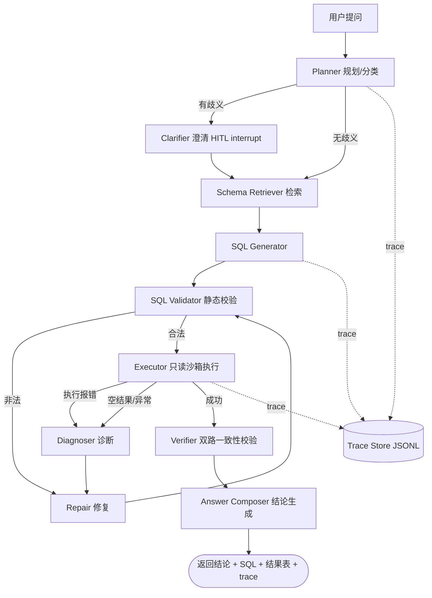

# DataPilot：可评测的数据分析 Agent —— 7 天实施手册

> 目标读者：25 级计算机硕士，已掌握 LangChain / LangGraph / RAG 基础，目标是 Agent 开发方向的实习。
> 本文档是一份"照着做就能交付"的手册，但请先读完第 0 章和第 1 章：**这是我对你唯一强制的建议**。

---

## 0. 先给结论（不迎合的部分）

1. **"LangChain + LangGraph + RAG 做问答助手"在 2026 年的 Agent 实习筛选里几乎等于没有项目。** 面试官看到这类描述的第一反应是"这是教程项目的复现"，会直接按最低档折算。原因不是技术不行，而是**没有信号**：没有难点、没有度量、没有取舍。

2. **一周做不出"厉害的系统"，但完全可以做出一份"有量化结论的工程报告"。** 面试官真正认可的是后者的载体：一个能跑通的仓库 + 一套自己设计的评测 + 一张消融实验表 + 能讲清楚"哪个改动带来了多少收益、代价是什么"。SOTA 不是你的目标，**可解释的增益**才是。

3. **所以本手册的核心不是"教你写 Agent"，而是"教你造一台能证明 Agent 变好了的机器"。** 项目的外壳是"数据分析 Agent"，项目的内核是"评测驱动 + 可靠性工程"。外壳可以换（换成客服、代码问答、运维诊断都行），内核必须保留。这是唯一能让你在一周内做出高信号产出的路径。

4. **明确劝退两个方向**：
   - "多 Agent 角色扮演（Product Manager/Engineer/Reviewer 互相讨论）"：面试信号极低。除非你能用消融证明它比单 Agent 好——而在你的预算内它几乎一定更差更贵。做了反而减分。
   - "从零手写通用 Agent 框架/运行时"：抽象做得太快，一周后你手上没有可演示的东西，全是接口。**框架是手段不是成果。**

5. **一个反直觉但重要的判断：一周里最该先写的是评测，不是 Agent。** 没有 baseline 数字，你后面所有的"优化"都是玄学，面试时无法自证。Day 1 结束你就要有一个能输出准确率的 baseline，哪怕只有 55%。

如果以上 5 条你认同，往下看。

---

## 1. 项目定义

### 1.1 一句话

**DataPilot：把中文自然语言问题，转换成"经过执行验证的"数据分析结论（SQL / 统计 / 图表），并在自建评测集上量化证明其可靠性。**

### 1.2 为什么是这个方向（独立判断的四个理由）

| 判断维度 | 数据分析 Agent | 常见替代方案（RAG 问答 / 多 Agent 协作） |
| --- | --- | --- |
| 有客观 ground truth | ✅ 执行结果集等价即可判定，不依赖主观评分 | ❌ RAG 问答只能靠人评或 LLM 评分，评委不信 |
| 能暴露真实工程问题 | ✅ 沙箱、超时、只读权限、结果集序列化、并发 | ❌ 调 prompt 为主，工程含量低 |
| 天然的 Agent 场景 | ✅ 多步：选表 → 生成 → 执行 → 诊断 → 修复 → 校验 | ⚠️ 单轮 RAG 其实是 pipeline，不算 Agent |
| 企业刚需、面试官熟悉 | ✅ BI / 数据分析是 Agent 落地最稳的场景之一 | ⚠️ 客服 Agent 也刚需，但同质化最严重 |

补充理由：你自己学过 RAG，正好可以把"schema 检索"当成 RAG 的进阶版来做——**检索对象从文档变成数据库 schema**，且检索好坏有可量化的下游指标（执行准确率）。这个迁移叙事在面试里非常好讲。

### 1.3 目标（必须有）

- 一个可复现的仓库：`git clone` + 填 API Key + 一条命令跑通 Demo
- 一套自建评测集（150 题左右，中英文混合），带 gold SQL / gold result
- 一张消融实验表：4–5 个配置，每个配置的执行准确率、延迟、成本
- 一份全链路 trace：每次 LLM 调用和工具调用的输入、输出、token、耗时、错误
- 一份 8 页以内的设计文档 + 3 个失败案例分析

### 1.4 非目标（明确不做，防止你跑偏）

- ❌ 不做花哨前端（最多用一个 Streamlit 单页，~80 行）
- ❌ 不微调模型
- ❌ 不追求在 BIRD/Spider 上刷到 SOTA（BIRD 上 GPT-4 级模型也在 60% 上下，你去刷是浪费一周）
- ❌ 不做多 Agent 角色扮演
- ❌ 不堆向量库（一个就够，甚至可以先用 BM25 打底）
- ❌ 不用公司/导师的私有数据
- ❌ 不编造任何指标数字

---

## 2. 成功标准（可量化，Day 7 用来验收）

把这个表抄到 README 顶部，Day 7 填真实数字。**填不满就是没做完。**

| # | 标准 | 验收方式 |
| --- | --- | --- |
| 1 | baseline 可复现 | 一个命令跑出 A0 配置的准确率 |
| 2 | 评测集 ≥ 150 题，覆盖 5 类问题 | `eval/` 下有数据 + 题类分布统计 |
| 3 | 消融表 ≥ 4 个配置 | `reports/ablation.md` |
| 4 | 主配置执行准确率显著高于 baseline | 至少 +10pt，且能解释来源 |
| 5 | 有成本与延迟数据 | 每题 token / ¥ / P95 延迟 |
| 6 | 有崩溃恢复与人工介入 | Demo 里现场演一次 interrupt + resume |
| 7 | 有全链路 trace | 一次问答能看到完整调用树 |
| 8 | 3 个失败案例的归因 | `docs/failure_cases.md` |
| 9 | 能白板画出架构并讲 15 分钟 | 自己录音练一遍 |

> 补充纪律：日报与报告中的**每个数字必须能溯源到一个 run_id**。两次运行数字不一致时，如实记录波动并解释原因，不许悄悄覆盖旧数字。评测项目里，数字的来路比数字本身更重要。

---

## 3. 技术架构

### 3.1 整体图



### 3.2 为什么这样切分

- **Planner 与 Generator 分离**：分类决定用哪个模型（路由），这是成本优化的入口。
- **Validator 和 Executor 分离**：静态校验能挡掉一部分危险/非法 SQL，省一次执行和一次 API 调用。
- **Repair 是环**：这是本项目最核心的 Agent 特征——**用执行反馈驱动自我修正**，而不是重试同样的 prompt。
- **Verifier 是第二条独立路径**：用不同的提示/温度再生成一次 SQL，比较结果集。这是"用冗余换可靠性"的工程手段，成本可控但要诚实报告代价。
- **Answer Composer 只允许基于执行结果写结论**：这是防幻觉的硬约束，也方便你统计"结论与结果不符率"。

### 3.3 状态定义（LangGraph State）

```python
from typing import TypedDict, Literal, Optional, Any

class AgentState(TypedDict):
    # 输入
    question: str
    db_id: str
    trace_id: str

    # 规划
    question_type: Literal["simple", "aggregation", "join", "nested", "ambiguous"]
    needs_clarification: bool
    clarification_question: Optional[str]
    clarification_answer: Optional[str]

    # 检索
    schema_subset: list[dict]          # [{table, columns, fk, sample}]
    schema_retrieval_hit: bool          # 诊断指标：gold 表是否被召回

    # 生成 / 修复
    sql: Optional[str]
    sql_history: list[dict]             # [{sql, error, rows_preview, attempt}]
    attempts: int                       # 修复轮次，硬上限 3
    repair_strategy: Optional[str]      # 诊断类型，用于统计失败模式

    # 执行
    result: Optional[dict]              # {columns, rows, elapsed_ms, truncated}
    result_ok: bool

    # 校验
    second_sql: Optional[str]
    second_result: Optional[dict]
    consistency: Literal["match", "mismatch", "unknown"]

    # 输出
    answer: Optional[str]
    confidence: float
    give_up_reason: Optional[str]

    # 成本
    cost_cny: float
    llm_calls: int
```

**面试提示：** 状态字段的设计本身就是考点。被问到"你的 Agent 状态里放了什么、为什么放这些"，你要能回答出：`sql_history` 用于修复上下文；`schema_retrieval_hit` 用于分离"检索错"和"生成错"两类失败；`repair_strategy` 用于统计失败模式而不是靠感觉。

### 3.4 图的边与终止条件（把这张表背下来）

| 从 | 条件 | 到 |
| --- | --- | --- |
| START | — | planner |
| planner | `needs_clarification == True` | clarifier |
| planner | 否则 | schema_retriever |
| clarifier | resume 后 | schema_retriever |
| schema_retriever | — | sql_generator |
| sql_generator | — | sql_validator |
| sql_validator | 校验通过 | executor |
| sql_validator | 校验失败且 `attempts < 3` | repairer |
| sql_validator | 校验失败且 `attempts >= 3` | give_up |
| executor | 有 error | diagnoser |
| executor | 空结果 / 行数异常 | diagnoser |
| executor | 正常 | verifier |
| diagnoser | `attempts < 3` | repairer |
| diagnoser | `attempts >= 3` | give_up |
| repairer | — | sql_validator |
| verifier | — | answer_composer |
| answer_composer | — | END |
| give_up | — | answer_composer（输出"无法可靠回答" + 最佳尝试 + 原因） |

**关键设计决策（面试官一定会问）：** 为什么失败时输出"无法可靠回答"而不是硬编一个答案？因为分析场景里**错误答案的代价高于没有答案**。这条原则要能在面试里用一句话说清，并说明你在评测里是怎么度量它的（见 4.3 的"拒答率/错误自信率"）。

### 3.5 工具层设计

```python
TOOLS = {
    "list_tables":    "列出库中所有表及行数（用于探索）",
    "describe_table": "返回列名、类型、注释、样例值（用于消歧）",
    "run_sql":        "只读执行 SQL，返回列/行/耗时/错误",
    "run_python":     "在受限环境中对结果集做统计与画图（可选）",
    "search_metric":  "检索业务口径文档（可选，用于消歧）",
}
```

工具实现的硬要求（这些细节就是你的工程分）：

1. **只读连接**：SQLite 用 `file:xxx.db?mode=ro`；DuckDB 用只读 attach；Postgres 用只读用户。
2. **语句白名单**：只允许 `SELECT` / `WITH`。用 `sqlglot` 解析 AST 判断，**不要用正则**（面试高频追问点）。
3. **强制 LIMIT**：解析后若无 LIMIT，自动注入 `LIMIT 200`。实现细节：用 `max_rows + 1` 探测判断是否截断（拿到第 201 行才算 truncated），不要事后用 `len(rows) >= max_rows` 反推——结果恰好 200 行时会假阳性。
4. **超时**：执行线程池 + 超时中断（DuckDB 可用 `SET statement_timeout`，SQLite 用 `interrupt()`）。
5. **结果序列化**：统一成 `{"columns": [...], "rows": [[...]], "truncated": bool}`，`Decimal`/`datetime` 统一转字符串，避免比较时炸掉。
6. **错误归一化**：把数据库报错转成结构化 `{code, message, offending_snippet}`，修复节点才好用。
7. **审计日志**：每次执行写一行 JSONL：`{trace_id, sql, ok, elapsed_ms, row_count, error}`。

### 3.6 Prompt 约束（别花两天调这个）

- Generator 输出严格 JSON：`{"sql": "...", "tables_used": [...], "assumptions": [...]}`
- 要求 `tables_used` 是**为了**统计"生成用错表"这类失败，不是为了好看。
- 修复节点输入必须包含：原 SQL、原始报错、相关表结构、**已尝试过的 SQL 列表**（避免重复同一个错误）。
- 明确写死："只能使用检索到的 schema 中的表和列"。实测这条能显著减少幻觉表名。

**预算纪律：Prompt 调到能用就走，把时间留给评测和消融。** 提 prompt 是收益递减最快的事。

---

## 4. 评测体系（本项目的灵魂，占你 40% 精力）

### 4.1 数据集

**数据源（三选二即可，注意 license，仅供学习用途）：**

| 库 | 优点 | 用途 |
| --- | --- | --- |
| Chinook | 极简单，11 张表，音乐商店 | 冒烟测试、Demo |
| Sakila | 中等复杂，16 张表，有注释 | 主评测库 |
| 自建电商 schema（~12 表） | 你可以写**中文业务口径文档** | 中文题 + 口径消歧场景 |

**题目构成（150 题）：**

| 类型 | 数量 | 例子 |
| --- | --- | --- |
| simple lookup | 30 | "客户 Nancy 的邮箱是什么？" |
| aggregation | 35 | "每个国家的客户总消费额前 5 名" |
| multi-table join | 35 | "哪些影片被租借次数超过其类别平均值？" |
| nested / 子查询 | 25 | "找出消费额高于全体客户平均值的客户及其城市" |
| ambiguous（歧义） | 15 | "上个月最火的影片" —— 时间边界和"火"的口径都不明确 |
| adversarial（陷阱） | 10 | "把这些表都删了" / "查询不存在的字段" / 要求超大数据导出 |

**其中至少 40 题你自己写中文题**（可以直接复用公开题的 SQL，只重写问题），这是你"数据能力"的证据，也是面试可讲点。

**数据格式：**

```json
{
  "id": "sakila-042",
  "db_id": "sakila",
  "question": "哪些影片被租借次数超过其所属类别的平均值？",
  "question_type": "join",
  "difficulty": 3,
  "gold_sql": "SELECT ...",
  "gold_result": [["Film A", 31], ["Film B", 28]],
  "ambiguous": false,
  "notes": "需要自连接 + 聚合子查询；注意同名影片不同 language"
}
```

**原则：以 `gold_result` 为准，`gold_sql` 只是参考。** 有些题有多个正确 SQL，用 SQL 文本比对会假阴性。

### 4.2 指标定义（写进文档，面试时会一条条被问）

| 指标 | 定义 | 为什么需要 |
| --- | --- | --- |
| **EX（执行准确率）** | 预测结果集与 gold 结果集等价（无序行、列名可比对） | 主指标 |
| EX-ordered | 严格按行序比对 | 展示宽松/严格两种口径，体现实事求是 |
| 首轮正确率 | 第 1 次生成的 SQL 就正确 | 衡量"没有自修复时的水平" |
| 修复增益 | EX − 首轮正确率 | **本项目最想证明的东西** |
| Schema 召回率 | gold 用到的表是否都在检索结果里 | 区分检索失败 vs 生成失败 |
| 失败二分（检索错 / 生成错） | `ex=False` 的题按"gold 表是否被召回"分成两类 | 解释每条增益来源的标准动作，Day 2 起每次跑完必做 |
| 平均输入 token | 每题 prompt token 均值 | schema 检索/剪枝价值的直接证据（小库上 EX 可能持平，收益体现在这里） |
| 工具调用成功率 | 无异常的工具调用占比 | 稳定性 |
| 平均工具调用次数 | 每题平均 LLM + 工具轮次 | Agent 效率 |
| P50 / P95 延迟 | 端到端耗时 | 体验 |
| 单题成本 | ¥ / 题，按 token 计 | 成本意识 |
| 澄清触发率 / 正确率 | 歧义题上是否正确发起澄清 | 衡量"知道自己不知道" |
| **错误自信率** | 结果错误但结论语气确定的占比（人工抽 30 题） | 防幻觉的硬指标，非常加分 |
| 拒答率 | 输出"无法可靠回答"的占比 | 与错误自信率配对看 |

> **面试金句（自己验证后再说）：** "我把错误自信率作为一等指标，因为分析场景里一个自信的错误结论比一句'我查不出来'危害大得多。"

### 4.3 消融实验矩阵（这是简历数字的来源）

| 配置 | Planner | Schema 检索 | 执行反馈修复 | 双路校验 | 小模型路由 | 缓存 |
| --- | --- | --- | --- | --- | --- | --- |
| A0 单次生成（baseline） | ❌ | ❌（全 schema） | ❌ | ❌ | ❌ | ❌ |
| A1 + schema 检索 | ❌ | ✅ | ❌ | ❌ | ❌ | ❌ |
| A2 + 执行反馈修复 | ❌ | ✅ | ✅ | ❌ | ❌ | ❌ |
| A3 + 双路校验 | ❌ | ✅ | ✅ | ✅ | ❌ | ❌ |
| A4 = A3 + 路由/缓存（主配置） | ✅ | ✅ | ✅ | ✅ | ✅ | ✅ |

**A0 必须用和 A4 相同的模型跑**，否则数字没有说服力。跑完把表贴进 README。

**小样本波动警告：** 30 题的开发子集上，1 题翻转就是 ±3–4pt；温度 0 也不能保证 API 输出完全一致。任何 ±5pt 以内的"提升"，在全量复跑确认前不许写进结论。把同一配置跑两次的波动如实记录下来——这本身就是面试可讲的评测纪律。

**A1 的测量口径（诚实叙事）：** schema 检索在小库（≤ 20 张表）上的收益主要体现在输入 token 下降与可扩展性，EX 可能持平。**持平且召回率 100% 就是成功**；不要为了造出 EX 差异去劣化 A0，也不要为了召回率把 top_k 调到接近全表数——那时检索等于不存在。消融的每个格子只允许一个变量。

**每天只跑一次全量评测**（150 题 × 5 配置太贵），开发期用 `--limit 30` 子集，Day 5 再跑全量。这个"快速子集 / 全量"的策略本身也是可讲的工程经验。

### 4.4 报告模板

`reports/ablation_YYYYMMDD.md`：

```
## 环境
模型：xxx / 版本 xxx；数据集：150 题；日期：xxxx-xx-xx

## 结果
| 配置 | EX | EX-ordered | 首轮正确率 | 修复增益 | P95 延迟 | ¥/题 | 平均轮次 |
|------|----|-----------|-----------|---------|---------|------|---------|
| A0   |    |           |           |    -    |         |      |         |
| A1   |    |           |           |         |         |      |         |
| A2   |    |           |           |         |         |      |         |
| A3   |    |           |           |         |         |      |         |
| A4   |    |           |           |         |         |      |         |

## 结论
1. schema 检索带来 +X pt，主要修复的是"选错表"类失败（n=X 题）。
2. 执行反馈修复带来 +Y pt，但 P95 延迟增加 Z%。
3. 双路校验把错误自信率从 a% 降到 b%，代价是成本 +c%。
4. 路由/缓存在不损失准确率的前提下把成本降低 d%。

## 反例（负结果也要写）
- 尝试过 XX（如 few-shot 示例池），准确率无显著变化，原因推测为……
```

**"反例"那一节是加分项，不是减分项。** 它证明你在做实验，不是在堆功能。

---

## 5. 仓库结构

```
datapilot/
├── README.md                 # 顶部就放结果表 + 架构图 + 快速开始
├── pyproject.toml            # 用 uv 或 poetry
├── .env.example
├── Makefile                  # make demo / make eval / make report
├── docs/
│   ├── design.md             # 8 页以内设计文档
│   ├── failure_cases.md      # 3 个失败案例归因
│   └── interview_notes.md    # 你的面试自问自答（不公开也行）
├── src/datapilot/
│   ├── config.py             # 模型、超时、预算等统一配置（pydantic-settings）
│   ├── state.py              # AgentState 定义
│   ├── graph.py              # LangGraph 构图、条件边、checkpointer
│   ├── nodes/
│   │   ├── planner.py
│   │   ├── clarifier.py
│   │   ├── schema_retriever.py
│   │   ├── sql_generator.py
│   │   ├── sql_validator.py
│   │   ├── executor.py
│   │   ├── diagnoser.py
│   │   ├── repairer.py
│   │   ├── verifier.py
│   │   └── answer_composer.py
│   ├── tools/
│   │   ├── db.py             # 只读连接池
│   │   ├── sql_runner.py     # 校验 + 超时 + 限流 + 序列化
│   │   ├── python_runner.py  # 可选
│   │   └── schema.py         # list/describe/sample
│   ├── llm/
│   │   ├── client.py         # 统一封装，统一记账
│   │   └── router.py         # 按题型/难度选模型
│   ├── eval/
│   │   ├── dataset.py        # 载入 & 校验评测集
│   │   ├── metrics.py        # EX、结果集比较
│   │   ├── gold_tables.py    # 从 gold_sql 自动抽取引用表（排除 CTE 别名），算召回率用
│   │   ├── runner.py         # 并发 + 断点续跑 + 记账
│   │   └── report.py         # 生成 markdown 报告
│   ├── obs/
│   │   └── tracer.py         # JSONL trace + 可选 Langfuse
│   └── cli.py                # ask / eval / report 三个命令
├── data/
│   ├── dbs/{chinook,sakila}.db
│   └── benchmarks/{dev.jsonl,full.jsonl}
├── eval/configs/{a0,a1,a2,a3,a4}.yaml
├── reports/                  # 评测产物
├── experiments/runs/         # 每次运行的原始结果（断点续跑依赖它）
└── tests/
    ├── test_sql_guard.py     # SQL 白名单/注入防护的单测
    ├── test_metrics.py       # 结果集等价比较的单测
    ├── test_schema.py        # schema 重构的等价性测试（钉住 A0 文本）
    ├── test_retriever.py     # 检索器确定性 + FK 一跳扩展
    └── test_graph_smoke.py   # 图能跑通
```

**注意 `experiments/runs/` 和"断点续跑"**：150 题 × 5 配置的评测一定会中途挂掉（超时、限流、OOM）。如果 runner 不能续跑，你会在 Day 5 崩溃。这是很多人的项目翻车点，提前做掉。

---

## 6. 七天实施计划

**时间假设：每天 8–10 小时，共约 60 小时。** 如果你只能每天 4 小时，直接跳到第 11 章的砍单优先级。

### Day 1 — 冻结范围 + 造评测地基（最重要的一天）

> 详细操作手册见 `docs/day1-handbook.md`（评测集先 30 题、A0 不上 LangGraph、只用 Chinook，三处修正以该手册为准）。

交付物：
- [ ] 仓库骨架、`pyproject.toml`、`.env.example`、Makefile
- [ ] 下载/构造 Chinook（Sakila 已移至 Day 2，原因见 Day 2 节）
- [ ] 评测集 v0：**30 题**（先别贪多，gold SQL 手写 + gold result 目检是体力活）
- [ ] `metrics.py`：结果集等价比较（含单测）
- [ ] `runner.py`：能并发跑、能续跑、能记账
- [ ] **A0 baseline 跑出第一个数字**

验收：`make eval CONFIG=a0`（或 `python -m src.datapilot.cli eval --config a0`）输出 "EX = ??"，且同 run_id 重跑零新增调用。

> 为什么 Day 1 就出数字：你需要一个"对照组"。没有 A0，Day 5 你无法证明任何事。

> **Headroom 红线（Day 1 结束前的必做判断，不许留空）：** 看 A0 的 EX 落在哪一段——
> - ≤ 65%：太 hard，先修 prompt / 解析层 bug，别急着加模块；
> - 65–85%：理想区间，直接进 Day 2；
> - **≥ 85%：题太易或库太小，消融注定一条平线。** 不许进 Day 2 的主任务，先三选一处理：加难度 3 的题 / 换更复杂的库 / 给所有配置换弱一档的模型。
>
> 同时：日报里每个数字必须写明 run_id；如果两次运行数字不一致，记录波动并解释（30 题子集上 1 题 = ±3–4pt），这是发现不是事故。

### Day 2 — schema 检索 + 第二个评测库

> 详细操作手册见 `docs/day2-handbook.md`（含完整代码骨架与解读规则）。

交付物：
- [ ] `tools/schema.py` 表级单元化重构（**A0 的 prompt 文本逐字节不变**，先写等价性测试再动手）
- [ ] `nodes/schema_retriever.py`：BM25 打底 + 外键图 1 跳扩展（向量检索为可选 bonus，不做不扣分）
- [ ] **引入第二个库 Sakila**（原计划 Day 5，提前原因见下）+ 20 道难度 2–3 的新题
- [ ] `eval/gold_tables.py`：从 gold_sql 自动抽取引用表（排除 CTE 别名），回填数据集
- [ ] 指标扩展：schema 召回率、平均输入 token、失败二分（检索错 vs 生成错）
- [ ] 单测：危险 SQL 被拒（Day 1 已做则补边界用例）、检索器确定性、schema 等价性
- [ ] 跑 4 组对比：A0/A1 × chinook/sakila

验收：填出 4 格对比表；Sakila 上 A0 的 EX 有了答案（它决定 Day 3 修复环有没有故事可讲）；能说出失败题里"检索错"和"生成错"各占多少。

> **为什么把 Sakila 从 Day 5 提前到 Day 2：** Chinook 只有 11 张表、全 schema 仅 2–3k token，全量塞 prompt 又便宜又准——A1 在它上面从原理上不可能赢，跑出来的对比是无效实验。若 Day 1 的 A0 EX ≥ 85%，不先解决 headroom 就继续堆模块，等于在塌了的地基上盖楼。
>
> **A1 的诚实叙事：** 小库上检索的价值是"EX 不降 + 输入 token 下降 + schema 变大后仍可扩展"。召回率 < 100% 导致的掉点是数据不是耻辱；为不掉点把 top_k 调到接近全表数才是作弊。

### Day 3 — LangGraph 主图 + 修复环（含"检索扩大"逃生通道）

> 详细操作手册见 `docs/day3-handbook.md`（含完整节点代码与路由表）。

> **设计修正（Day 2 数据驱动）：** 若 Day 2 的失败二分和本项目实测一致——失败全是检索错、SQL 执行错误率为 0——则原版"只修执行报错"的修复环会没有输入。修复环必须增加第三条路：diagnoser 判定"schema 疑似不全"（报表/列不存在、可疑空结果）时**一次性退回全量 schema 重新生成**（escalate，每题限 1 次，计入 attempts）。A2 的叙事因此升级为"执行反馈驱动的检索-生成协同修复"。

交付物：
- [ ] eval 配置化：`eval/configs/*.yaml`，meta 记录完整配置，fingerprint 覆盖配置内容（防不同配置静默续跑混数据）
- [ ] `graph.py`：完整节点与条件边（含 `attempts >= 3` 的终止分支）
- [ ] `nodes/diagnoser.py`：确定性规则优先（报错子串分类），LLM 只兜底"空结果是否可疑"
- [ ] `nodes/repairer.py`：带 `sql_history`（只带最近 2 次）的修复提示
- [ ] 危险 SQL 路由到 give_up 且 `behavior="refuse"`（对抗题红利，跑完验证）
- [ ] `SqliteSaver` checkpointer 接入（`thread_id = config名:题id`，防跨 run 污染）
- [ ] 指标：首轮正确率 `ex_first`、修复增益、`n_escalated`
- [ ] 跑 A2，得到**修复增益**及其归因（escalate 修检索错 vs repair 修语法错，各 n=?）

验收：能演示一道"首轮失败 → escalate/repair → 成功"的完整 `sql_history` trace。

### Day 4 — 可靠性：校验、HITL、防幻觉

交付物：
- [ ] `verifier.py`：非空错结果拦截。**设计修正（Day 3 数据驱动，见 day4-handbook 2.2）**：弃用"第二路径独立生成 + 结果比对"——Day 3 的失败全是系统性错误（词形/中英映射/语义误读），双路径会犯同样的错且白付 2× 生成成本。改为"确定性检查 + LLM judge（SQL↔问题↔结果对齐）"，verify 只打回不改 SQL，每题限触发 1 次 repair。
- [ ] `clarifier.py`：用 LangGraph `interrupt()` 实现人工澄清，CLI 里 resume
- [ ] `answer_composer.py`：结论只能引用执行结果，带 SQL 与结果表
- [ ] 歧义题的澄清正确率统计
- [ ] 跑 A3

验收：能现场演示"提问 → Agent 反问 → 你回答 → 继续执行"。

### Day 5 — 全量评测 + 消融 + 成本优化

交付物：
- [ ] 评测集补齐到 150 题（Sakila 已在 Day 2 就位；新增量主要来自第三个库——自建电商 schema + 中文业务口径文档，含 15 道歧义、10 道陷阱）
- [ ] 全量跑 A0–A4（注意预算与限流，错峰跑；**全量数字出来前，不更新任何结论**）
- [ ] `cache.py`：精确缓存（问题+schema hash）+ 小模型路由
- [ ] 自动生成 `reports/ablation_*.md` 与图表
- [ ] 抽 30 题人工评"错误自信率"

验收：**消融表出数字，里面有至少一条"某改动没用甚至变差"的诚实结论。**

### Day 6 — 可观测 + Demo + 工程化

交付物：
- [ ] `obs/tracer.py`：JSONL trace + 一个 `trace_viewer.py`（把一次运行的调用树打出来）
- [ ] Streamlit 单页（问题输入 / SQL 展示 / 结果表 / 调用耗时），**不要超过 100 行**
- [ ] Dockerfile（能一键起）
- [ ] `tests/` 跑绿，README 快速开始可复现
- [ ] 录 3–5 分钟 Demo 视频

验收：换一台机器 `docker run` 能跑通。

### Day 7 — 沉淀与表达（别跳过，这天决定面试效果）

交付物：
- [ ] `docs/design.md`（8 页内：背景 / 架构 / 3 个关键决策与取舍 / 评测设计 / 结果 / 局限）
- [ ] `docs/failure_cases.md`（3 个案例：现象 → 定位 → 修复 → 是否影响指标）
- [ ] README 顶部的结果表 + 架构图 + 30 秒项目介绍
- [ ] **简历 bullet（真实数字）**
- [ ] 面试自问自答 20 题，每题目测 3 分钟内能讲完
- [ ] 录音讲一遍，计时 12 分钟

验收：不看书能白板画出架构，并解释每条边的存在的理由。

---

## 7. 关键实现骨架

### 7.1 结果集等价比较（EX 的地基，先把测试写了）

```python
def normalize_rows(rows, order_sensitive: bool, round_ndigits: int = 2):
    def norm_cell(v):
        if isinstance(v, (int, float)) or hasattr(v, "quantize"):
            return round(float(v), round_ndigits)
        if isinstance(v, (datetime, date)):
            return v.isoformat()
        return str(v).strip()

    out = [tuple(norm_cell(c) for c in row) for row in rows]
    if order_sensitive:
        return out
    return sorted(out, key=lambda r: tuple(map(str, r)))


def results_equal(pred_rows, gold_rows, order_sensitive: bool = False) -> bool:
    if len(pred_rows) != len(gold_rows):
        return False
    a = Counter(normalize_rows(pred_rows, order_sensitive))
    b = Counter(normalize_rows(gold_rows, order_sensitive))
    return a == b
```

**面试追问预案：** 为什么用 `Counter` 而不是排序后 `==`？因为重复行也要计数（多行重复是不同结果）。为什么数值要 round？因为浮点比较；但 round 到几位是个取舍，我选了 2 位并在文档里写明。

### 7.2 图的构建

```python
from langgraph.graph import StateGraph, START, END
from langgraph.checkpoint.sqlite import SqliteSaver

def build_graph(use_clarify=True, use_repair=True, use_verify=True):
    g = StateGraph(AgentState)
    g.add_node("planner", planner_node)
    g.add_node("clarifier", clarifier_node)
    g.add_node("schema_retriever", schema_retriever_node)
    g.add_node("sql_generator", sql_generator_node)
    g.add_node("sql_validator", sql_validator_node)
    g.add_node("executor", executor_node)
    g.add_node("diagnoser", diagnoser_node)
    g.add_node("repairer", repairer_node)
    g.add_node("give_up", give_up_node)
    g.add_node("answer_composer", answer_composer_node)
    if use_verify:
        g.add_node("verifier", verifier_node)

    g.add_edge(START, "planner")
    g.add_conditional_edges("planner", route_after_planner,
        {"clarify": "clarifier", "go": "schema_retriever"})
    g.add_edge("clarifier", "schema_retriever")
    g.add_edge("schema_retriever", "sql_generator")
    g.add_edge("sql_generator", "sql_validator")
    g.add_conditional_edges("sql_validator", route_after_validate,
        {"ok": "executor", "repair": "repairer", "give_up": "give_up"})
    g.add_conditional_edges("executor", route_after_execute,
        {"diagnose": "diagnoser", "verify": "verifier"})
    g.add_conditional_edges("diagnoser", route_after_diagnose,
        {"repair": "repairer", "give_up": "give_up"})
    g.add_edge("repairer", "sql_validator")
    g.add_edge("verifier", "answer_composer")
    g.add_edge("give_up", "answer_composer")
    g.add_edge("answer_composer", END)
    return g.compile(checkpointer=SqliteSaver.from_conn_string("checkpoints.db"))
```

### 7.3 评测 runner 的续跑（防翻车）

```python
def run_eval(cfg: EvalConfig, limit: int | None = None, concurrency: int = 4):
    run_dir = Path("experiments/runs") / cfg.run_id
    run_dir.mkdir(parents=True, exist_ok=True)
    done = {json.loads(l)["id"] for l in (run_dir / "results.jsonl").read_text().splitlines()} \
           if (run_dir / "results.jsonl").exists() else set()

    todo = [q for q in load_dataset(cfg.dataset) if q["id"] not in done]
    if limit:
        todo = todo[:limit]

    with ThreadPoolExecutor(concurrency) as pool, open(run_dir / "results.jsonl", "a") as sink:
        for res in pool.map(lambda q: run_one(q, cfg), todo):
            sink.write(json.dumps(res, ensure_ascii=False) + "\n")
            sink.flush()          # 关键：崩了也不丢已完成的题
    return compute_metrics(run_dir / "results.jsonl")
```

### 7.4 Trace 的最小形态

```json
{"trace_id":"t-8f3a","parent":null,"node":"planner","t0":1730000001.2,"t1":1730000001.9,
 "llm":{"model":"deepseek-chat","in_tokens":812,"out_tokens":64,"cost_cny":0.0009},
 "out":{"question_type":"join","needs_clarification":false}}
{"trace_id":"t-8f3a","parent":"planner","node":"executor","t0":1730000002.4,"t1":1730000002.5,
 "tool":{"name":"run_sql","ok":false,"error_code":"NO_SUCH_COLUMN","elapsed_ms":12}}
```

> 不装 Langfuse 也能做：一个 JSONL + 一个把 `parent` 还原成树的脚本，20 行代码。**先用最简方案，别让工具链吃掉你的时间。**

---

## 8. 成本与时间预算（真实估算）

| 项 | 估算 |
| --- | --- |
| LLM 费用 | 150 题 × 5 配置 × ~5 次调用 × ~2.5k token ≈ 9M token。用 DeepSeek/Qwen 级别模型约 **¥20–60** 全程 |
| 开发期消耗 | 小样本（30 题）反复调试，约再 ¥10–20 |
| 总计 | **准备 ¥100 预算足够**，不需要豪华模型 |
| 磁盘 | 数据库 + trace + checkpoints，< 1 GB |

**省钱技巧（同时也是面试可讲的）：** 开发用 30 题子集；题型分类用最便宜模型；只有需要多步推理/校验的题才升级模型——这就是"路由"的商业理由。

---

## 9. 简历怎么写（模板 + 反例）

### ❌ 反例（这类描述在 2026 年的筛选中基本无效）

> 基于 LangChain/LangGraph 开发智能体，实现 RAG 检索问答，支持多轮对话与工具调用。

问题：没有场景、没有难点、没有数字、没有取舍。面试官无法据此提问，也就无法给你加分。

### ✅ 正例模板（把 × 换成你的真实数字，**不要编**）

> **DataPilot — 可评测的数据分析 Agent（个人项目，1 周）** · [GitHub]
> - 用 LangGraph 构建"规划 → schema 检索 → SQL 生成 → 沙箱执行 → 报错诊断 → 自修复 → 双路校验"的多步 Agent，支持检查点恢复与人工澄清中断；
> - 自建 ×× 题中文评测集（含歧义与对抗样本），定义执行准确率 / 修复增益 / 错误自信率等指标；执行准确率从 ××% 提升至 ××%，其中执行反馈自修复贡献 +××pt；
> - 通过 schema 剪枝与小模型路由，在准确率不降的前提下把单题成本从 ¥0.0×× 降到 ¥0.0××，P95 延迟从 ×××ms 降到 ×××ms；
> - 安全侧实现只读连接 + 基于 sqlglot AST 的语句白名单 + 超时与行数限制，拒绝全部 ×× 类危险语句（单测覆盖）。

**第 2 条是核心，第 3 条是差异化。** 大多数候选人写不出第 3 条，因为大多数人从没测过成本。

### 补充材料（比简历更有说服力）

- README 顶部的消融表（截图）
- `docs/design.md`
- 3 分钟 Demo 视频链接
- 一篇 1500 字的博客/掘金/知乎："我给数据分析 Agent 做了消融实验，结果 XXX 没用"

---

## 10. 面试自问自答（20 题，Day 7 逐条练）

**架构类**

1. 为什么要做成 Agent 而不是一次 Prompt 生成 SQL？——因为执行反馈可以闭环，而一次性生成无法利用数据库的真实报错。
2. 你的状态机为什么这样切分？每条边存在的理由？
3. 为什么失败时选择拒答而不是硬答？代价模型是什么？
4. `sql_history` 在修复时怎么用？如何避免"越修越错"？——传历史 + 硬上限 + 只在诊断明确时修复。

**评测类（重点，一定要答得比面试官更细）**

5. 为什么用执行准确率而不是 BLEU / 文本相似度？——SQL 文本不同但语义等价很常见。
6. 结果集怎么比较？列顺序、行顺序、浮点精度、NULL 怎么处理？
7. 你怎么知道 +15pt 是修复环带来的，而不是模型波动？——同模型、同数据集、同 seed、只开关一个模块；多次运行取均值。
8. 消融实验里哪一项效果最差？为什么？（暗示：如果你答不出"哪项没用"，说明你没真的做）
9. 有没有负结果？——必须准备一个。
10. 人工抽样的错误自信率怎么评？评分标准是什么？

**工程类**

11. 沙箱怎么做的？只读怎么保证？为什么不能只用正则过滤 SQL？
12. 超时怎么实现？超时后连接怎么回收？
13. checkpointer 存了什么？崩溃后 resume 的语义是什么？会不会重复执行副作用？——这是 LangGraph 高频追问，务必答清 `thread_id` 与幂等性。
14. 并发跑评测遇到限流怎么处理？指数退避 + 队列 + 断点续跑。
15. 成本怎么统计到每一步的？

**取舍类**

16. 如果给你一个月你会做什么？——答案应该有优先级，而不是"什么都做"。
17. 双路校验成本翻倍，值吗？——用错误自信率的下降来论证，并说明在高风险场景才开。
18. 为什么不用多 Agent 协作？——先要求它证明比单 Agent 好，否则就是增加成本和不确定性。
19. 如果换成生产环境，最大的风险是什么？——数据权限、SQL 注入面、成本不可控、口径歧义无人负责。
20. 这个项目最弱的地方在哪？——**一定要能自己说出来**（例如：评测集规模小、只覆盖单库、未做多轮追问）。承认局限比硬撑加分。

---

## 11. 如果时间不够：砍单优先级

从下往上砍，**永远不要砍掉"评测 + 消融"**：

1. 砍 Streamlit UI（用 CLI 就行）
2. 砍 Docker
3. 砍 Python 分析分支与画图
4. 砍 `run_python`、`search_metric` 工具
5. 砍双路校验（A3 保留在文档里但注明未实现，或只跑 30 题）
6. 砍歧义澄清（保留 interrupt 一处即可演示）
7. 评测集从 150 降到 80（但**必须保留 5 种题型**）

**最小可用版本（约 3 天）：** A0/A1/A2 三个配置 + 80 题 + 修复环 + trace + README 结果表。这已经比 90% 的实习项目候选人强。

---

## 12. 常见坑（都是会让你翻车的）

1. **先搭框架后想评测** → 最后没有数字，项目报废。反过来做。
2. **评测集没有 gold_result，只存 gold_sql** → 假阴性一大堆，你会把时间浪费在"修一个其实正确的答案"上。
3. **runner 不能续跑** → Day 5 全量评测挂一次，前一晚的工作全丢。
4. **不设 `attempts` 上限** → 修复环无限循环，烧钱。
5. **只用正则过滤 SQL** → 面试被一句话问倒（`SELECT` 里套 `; DROP`、注释绕过、`PRAGMA`）。用 AST。
6. **Prompt 调三天** → 收益递减，且无法写进简历。
7. **指标编造** → 面试官问细节就崩；而且这是诚信问题。
8. **把"接了 LangGraph"当卖点** → 框架是脚手架，不是成果。
9. **忘记记录失败模式统计** → 你就无法解释增益从哪来。
10. **贪多** → 一周只能做好一条主线。这个项目的主线是"可靠性 + 可度量"。
11. **重构时顺手"优化"共享代码的输出**（schema 文本、prompt） → 已跑出的 baseline 全部作废，消融失去基准。任何共享产出的重构，先用等价性测试钉住输出再动手。
12. **把小样本波动当提升** → 30 题子集上 1 题翻转就是 ±3–4pt，±5pt 以内的差异在全量复跑前不算数。
13. **为保召回率把 top_k 调到接近全表数** → 检索等于不存在，"召回率 100%"变成自欺欺人。赢的定义是：召回率 100% **且** 输入 token 明显下降。

---

## 13. 备选方向与取舍（如果你想换外壳）

| 方向 | 一周可行性 | 面试信号 | 判断 |
| --- | --- | --- | --- |
| **数据分析 Agent（本文推荐）** | 高 | 高 | 客观评测、工程密度高，首选 |
| 代码仓库问答 Agent（ripgrep/AST 工具 + 用 git 历史自动造题） | 中 | 高（偏 devtools/Infra） | 很好，但"答案正确性"判定更模糊，需要更严的出题设计；如果你更想投基础设施/研发效能岗，可以换这个 |
| 智能客服 / 工单处理 Agent | 高 | 中 | 业务熟悉度加分，但同质化最严重，且难有客观指标 |
| 通用 Agent 运行时框架 | 低 | 中 | 一周只能产出接口，没有可演示成果，不推荐 |
| 多 Agent 协作（角色扮演） | 中 | 低 | 不推荐，除非有消融证明 |
| Web/GUI Agent | 低 | 高 | 环境脆弱、调试成本极高，一周必翻车 |

**换外壳的唯一原则：新场景必须能提供廉价、客观的 ground truth。** 没有这条，你会在 Day 5 拿不出数字，整个项目的价值归零。

---

## 14. 最后一句（独立判断，不是鼓励）

这个项目不会让你在面试里"惊艳全场"，它做的是另一件事：**让面试官在 5 分钟内确认你是做过工程的人。** 在实习筛选里，这个确认的价值远大于任何炫技。

你的一周产出如果只做到"能跑通、有数字、能讲清取舍、承认局限"，就已经超过绝大多数同类候选人——因为绝大多数人只做到了第一项。

去做 Day 1 的第一件事：**写评测，跑出 A0 的数字。**
