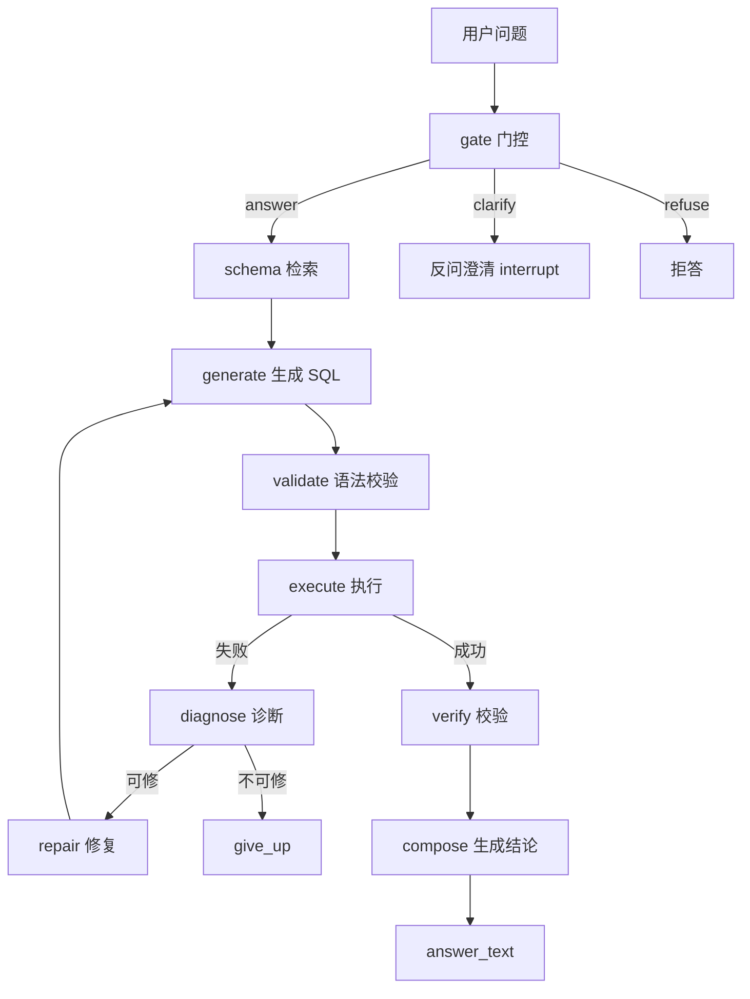

# DataPilot 设计文档

> 8 页内。评判标准：面试官读完能自己复述架构和取舍。
> 本文所有数字可溯源到 `experiments/runs/v2_{库}_{配置}`。

## 1. 背景与问题定义

**解决什么**：把自然语言问题翻译成可信的 SQL 查询 + 自然语言结论。

**给谁用**：不会写 SQL 的业务/产品人员，需要从关系库里拿数、且希望拿到的数附带一句"可信的结论"而不是一张裸表。

**为什么值得做**：LLM 直接生成 SQL 有两个致命问题，现有工具链没有量化它们——

1. **答错**：语义误解（"在库总数量"被理解成"库存件数"而非"商品数"）、枚举猜错（`status='on'` 被猜成 `'在售'`）、业务口径混乱（GMV 到底算 `payments.amount` 还是 `order_items` 快照）。
2. **答错还自信**：模型会对着一个错误的结果集，编出一句听起来很笃定的结论。

本项目的目标不是"又一个能跑的 SQL Agent"，而是用**评测先行 + 消融矩阵**回答一个更难的问题：**每一个可靠性组件（检索 / 修复环 / 门控 / 校验 / 缓存路由）到底有没有用、代价多大？**——大多数"Agent 项目"只会说"我们加了 X 提升了 Y"，本项目要证明"加了 X 到底值不值"。

## 2. 系统架构

每个节点一句话职责：

| 节点 | 职责 | 为什么这样切 |
| --- | --- | --- |
| gate | 三分类：answer / clarify / refuse | 在最前挡歧义（反问）和危险（拒答），避免生成器瞎猜 |
| retrieve | BM25 + 外键一跳检索 schema | 控输入 token；大库塞全量 schema 又贵又不准 |
| generate | 生成 SQL | 单一职责，只做"翻译" |
| validate | 语法校验（sqlglot） | 用确定性工具挡语法错，不浪费 LLM 调用 |
| execute | 执行 SQL | 隔离副作用，捕获执行错误 |
| diagnose | 确定性规则分类失败原因 | 报错子串分类优先，LLM 只兜底"空结果是否可疑" |
| repair | 带 sql_history 的修复提示 | 最多 3 轮，防死循环 |
| verify | 确定性 guard（降级后） | 兜底客观异常（整列 NULL/截断），零成本 |
| compose | LLM 生成自然语言结论 | 交付物是"结论"不是"SQL" |

**关键设计**：用 LangGraph 的 `StateGraph` 组织，`checkpointer` 用 SQLite（`thread_id = 配置:题id` 防跨 run 污染），支持 `interrupt()` 做 HITL 澄清（clarify 时挂起等人答）。

## 3. 关键决策与取舍

### 决策 1：失败时选择"拒答"而不是"硬答"

gate 对危险 SQL（写操作）和超纲问题直接 `refuse`，而不是让模型硬生成一个大概率错的答案。

- **代价**：可能误拒（`gate_false_kill`）。
- **处理**：Day 5 用"fail-open 收紧"（题面已给口径就判 answer）把三库误杀从 6/8 归零。
- **取舍逻辑**：一次"硬答"产生的是**看起来正确但其实是错的答案**，比"明确说答不了"危害大得多——这是"可靠性优先于覆盖率"的取舍。

### 决策 2：修复环上限 3 轮，且"检索扩大"（escalate）比"语法修复"（repair）更关键

- Day 3 实测发现：失败几乎全是**检索错**（schema 不全），而非语法错。所以修复环的核心是 **escalate**（diagnoser 判定"schema 疑似不全"时，一次性退回全量 schema 重新生成），而非逐条修语法。
- 3 轮是防死循环的硬上限，超过就 `give_up`。
- **教训**：修复环的形态要**由失败分布驱动**，而不是想当然地"修语法"。

### 决策 3：verifier 从"LLM judge"降级成"确定性 guard"（本项目最诚实的负结果）

- 原设计：verify 用 LLM 做"SQL ↔ 问题 ↔ 结果"对齐判断，判错打回 repair。
- 实测：三库 `verify_fixed` 全 0（LLM judge 一题都没救回来），但买到了 0 误杀、代价是 token +150%。
- **决策**（按 Day 5 定的决策树）：砍 LLM judge，只留 `deterministic_flags`（整列 NULL / 全 NULL / 截断）做零成本 guard。
- **结果**：降级后重跑，EX 不降反升（chinook_a3 79.2%→83.3%、ecommerce_a3 81.4%→90.7%）。
- **面试要点**：这是一个"我做了个没用的东西，然后用数据证明它没用，最后把它砍了"的完整工程闭环——比"verifier 提升了 2 个点"可信得多。

## 4. 评测设计

### 数据集怎么造

- **三个库**：chinook（30 题）、sakila（20 题）公开教学库 + **自建 ecommerce（60 题，12 表，seed=42 确定性可复现）**。
- **为什么自建第三库**：chinook/sakila 是公开库，模型训练语料大概率见过，EX 里"背过"的成分无法证伪。自建 schema 模型绝对没见过，它上面的 EX 才是**泛化能力的下限估计**。
- **gold 三件套**：`gold_sql`（手写）+ `gold_result`（目检）+ `gold_tables`（从 SQL 自动抽取）。`verify-gold` 自洽校验：gold_sql 能精确复现 gold_result，杜绝"手写答案对不上 SQL"的造假。
- **业务口径**：ecommerce 配了 `glossary.md`（成交=paid/shipped/completed、GMV=payments.amount 求和、在售=status='on'）。

### 指标怎么定义

- **EX**：执行结果等价（多重集比较，`normalize_rows` + `order_sensitive`），**不是文本相似度**——SQL 写法千千万，文本相似会误判，执行结果才是"对不对"的唯一真相。
- 扩展指标：`ex_first`（首轮）、`repair_gain`（修复增益）、`schema_recall`（检索召回）、`behavior_ok`（特殊题行为正确率）、`gate_false_kill`（门控误杀）、`verify_fixed`（校验修复）、单题成本、P95 延迟。

### 主动规避的"格式陷阱"

1. **temperature=0**：减少同题翻转波动。
2. **三段式指纹**（数据集-prompt-配置）：防改 prompt 后静默续跑旧 run 混数据。
3. **tie-breaker 写死**：gold 排序都带稳定 tie-breaker，防并列无序误判。
4. **枚举值采样 / 口径进 prompt**：把 `status='on'`、成交口径、排名口径写进 SYSTEM，避免模型猜。

### 已知局限

- **小样本**：30/20/60 题，1 题 = ±4pt，±5pt 内不下结论。
- **headroom 不足**：ecommerce 的 A0=88.4% 越过 85% 红线，该库"难题"对当前模型不够难。
- **错误自信率样本少**：仅 30 条抽评，2/30 ≈ 6.7%。

## 5. 实验结果

消融矩阵（v2，prompt 指纹 `c1038e268edf`）：

| 库 | 配置 | EX | 首轮EX | 修复增益 | 召回率 | 行为正确率 | ¥/题 |
| --- | --- | --- | --- | --- | --- | --- | --- |
| chinook | a0 | 75.0% | — | — | — | 0% | 0.0041 |
| chinook | a3 | 83.3% | 79.2% | 4.2% | 91.7% | 83.3% | 0.0105 |
| sakila | a0 | 72.2% | — | — | — | 0% | 0.0042 |
| sakila | a3 | 72.2% | 66.7% | 5.6% | 66.7% | 100% | 0.0150 |
| ecommerce | a0 | 88.4% | — | — | — | 0% | 0.0045 |
| ecommerce | a3 | 90.7% | 81.4% | 9.3% | 93.0% | 76.5% | 0.0097 |

**三条结论 + 至少一条负结果**：

1. **消融曲线健康**：A1 检索引入损失（漏召砍 EX）→ A2/A3 修复环回补 → A3/A4 到顶。ecommerce 是唯一 A3>A0（90.7% vs 88.4%，但 headroom 不足所以增益被压缩），chinook 的 A3>A0（83.3% vs 75.0%）headroom 充足、故事最完整。
2. **负结果 1**：A1 检索三库全比 A0 低（sakila -16.6、ecommerce -7.0）——检索省 token 的代价是 EX 回退，这是 A2/A3 修复增益存在的前提。
3. **负结果 2**：verifier LLM judge 零收益（`verify_fixed` 全 0）→ 降级，EX 不降反升。
4. **负结果 3**：chinook_a2（70.8%）比 a1（75.0%）还低——修复环在 chinook 上未产生正收益（单题波动，样本小不构成结论，但如实记录）。

## 6. 局限与已知问题

- **ecommerce headroom 越线（88.4%）**：41 道 difficulty=3 题里 A0 只错 5 道，CTE/窗口/递归对当前模型已不是门槛。评测难度还需上调。
- **错误自信率样本少（30 条）**：2 条过度断言都是"截断当全体 / NULL 未标注"的表达瑕疵，非编造幻觉——说明 composer 的"严格基于结果集"约束基本生效，但"截断边界和 NULL 处理"还需要更显式的约束。
- **枚举值没进 schema**：`status='on'`、`active=1/0` 这类取值模型猜错，是反复出现的系统性短板，根治是 schema 枚举值采样（Day 2 搁置、Day 5 复发）。
- **排序并列（tie-breaker）**：模型在 RANK/ROW_NUMBER 间摇摆，已用 prompt 硬规则压制，但这是 Text-to-SQL 的系统性难点。
- **小样本波动**：1 题 = ±4pt，所有"增益"都要在这个噪声下解读。
